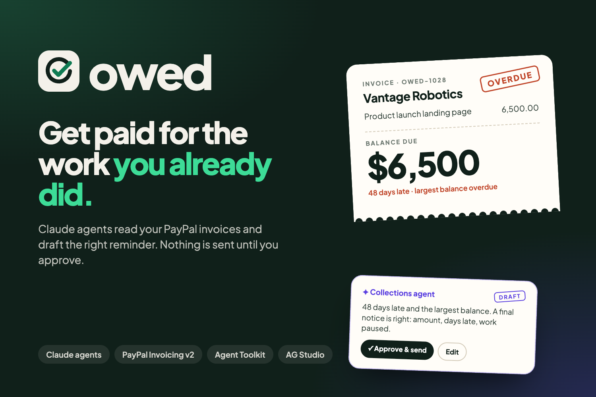
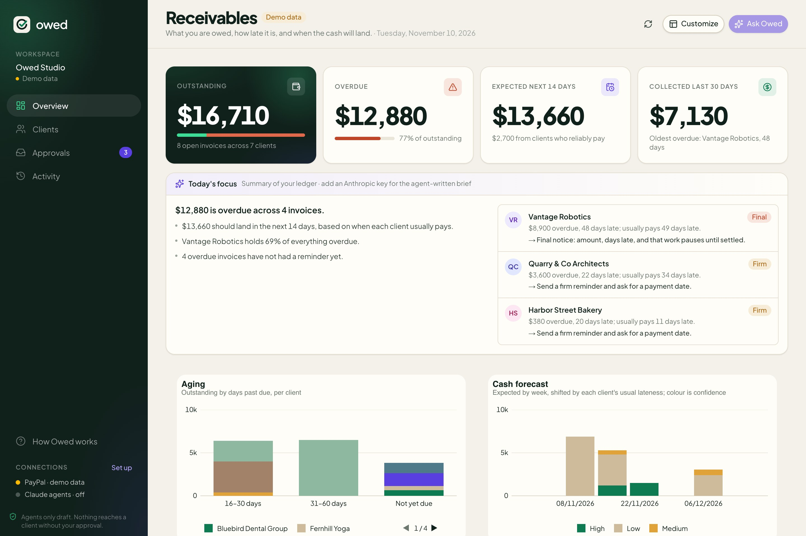
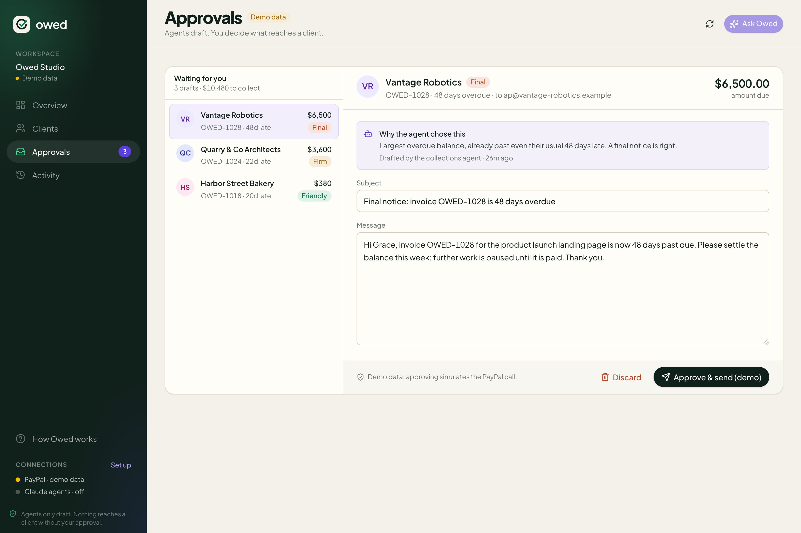
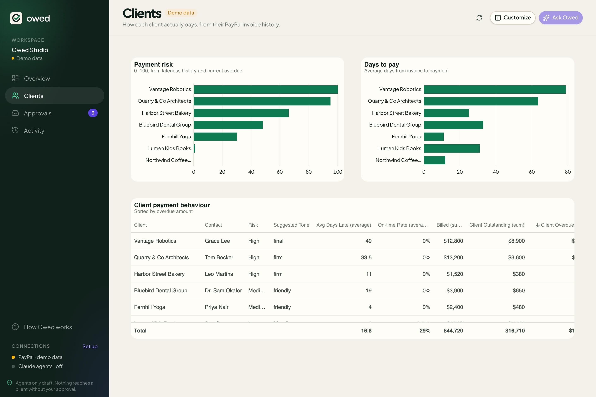
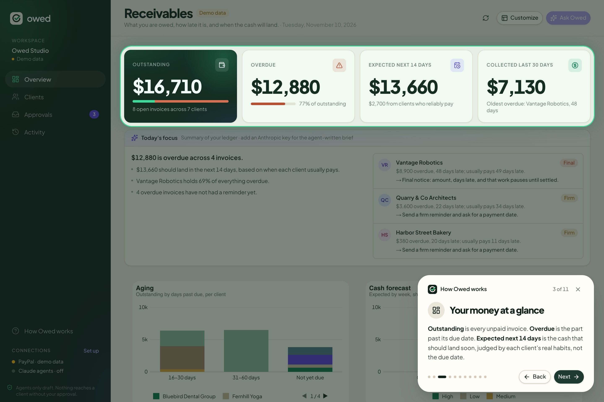

<p align="center">
  
</p>

<p align="center">
  <a href="https://owed.edilsonsantos.co.za"><b>Live demo</b></a> ·
  <a href="https://www.youtube.com/watch?v=ZhHI00SAyu8"><b>Demo video</b></a> ·
  <a href="https://devpost.com/software/owed-mi23or"><b>Devpost</b></a> ·
  <a href="LICENSE">MIT licence</a>
</p>

# Owed

**An AI collections copilot for freelancers and small studios who bill through PayPal invoices.**

Late payments are the cash-flow problem of small service businesses: the work is done, the invoice is
sent, and then someone has to notice it is overdue, work out how hard to push this particular client, and
write the awkward email. Most freelancers either chase too late or chase everyone the same way.

Owed reads your PayPal invoices, learns how each client actually pays, and has Claude agents draft the right
reminder for each overdue invoice: friendly for a good client who slipped, firm for a habitual late payer,
final for 45+ days. Every draft lands in an **approval queue**; nothing reaches a client until you press
**Approve & send**, which sends the reminder through PayPal's Invoicing API. All of it sits inside an
AG Studio dashboard the same agents can rebuild on request.

Built for the [PayPal AI Hackathon](https://paypalaihackathon.devpost.com/) (Oct–Nov 2026) by
[Edilson Santos](https://edilsonsantos.co.za).

**Live demo:** <https://owed.edilsonsantos.co.za>. The landing page is public; the dashboard needs a sign-in
(DataSparkLab SSO, powered by Logto). Judges can use the test account given in the Devpost testing notes.
A first-visit walkthrough opens each page in turn.

| | |
| --- | --- |
|  |  |
| **Overview.** Outstanding, overdue and expected cash, today's focus, aging and a habit-aware cash forecast. | **Approvals.** Every agent draft with its tone and reasoning. Edit, then approve and send through PayPal, or discard. |
|  |  |
| **Clients.** A payment profile and 0–100 risk score per client, from their PayPal history. | **Walkthrough.** First-time users are guided page by page, with each part spotlighted. |

## What it does

- **Live receivables dashboard** (AG Studio) over your PayPal sandbox invoices: outstanding and overdue,
  aging by client, open invoices most-overdue-first, and a **cash forecast** that shifts each due date by
  that client's real payment habit.
- **Client payment profiles**: average days to pay, days late, on-time rate and a 0–100 risk score per client,
  computed from PayPal invoice and payment history.
- **A team of agents in the dashboard chat**: AG Studio's five built-in agents (lead, planning, data, page,
  widget) plus Owed's own **collections agent**. Ask "who owes me money? draft reminders" and the lead
  delegates to collections; ask "add a chart of overdue by client" and it delegates to the dashboard agents.
- **Human-in-the-loop by design**: agents can only *draft*. You edit the subject or message, then approve;
  Owed calls `POST /v2/invoicing/invoices/{id}/remind` (or creates and sends a new invoice). An audit log
  records who did what: agent drafted, you sent.
- **Morning brief**: a server-side Claude agent uses **PayPal's Agent Toolkit** (read-only tools:
  `list_invoices`, `get_invoice`, `list_transactions`, `list_disputes`…) to investigate the account and
  write a three-line briefing with today's focus clients.
- **Guided onboarding**: an 11-step walkthrough on first visit that opens every page and spotlights what it
  explains, ending on what to connect (reopen it from **How Owed works** in the sidebar).
- **Admin**: `/admin` lists sign-ups, visible only to holders of the `owed-admin` Logto role.
- **Demo mode**: with no PayPal credentials, Owed runs on a built-in scenario (seven clients, six months of
  invoices) so anyone can try it in under a minute.

## How AI is used

| Where | Model / tool | What it does |
| --- | --- | --- |
| Dashboard chat (6 agents) | Claude Sonnet 5.5 (Haiku 5.5 selectable; Opus 5.5 with `OWED_ALLOW_OPUS=1`) via the Anthropic Messages API, prompt-cached, with a daily spend cap (`OWED_DAILY_BUDGET_USD`, default $2) | AG Studio's Agent Framework runs the agents in the browser; Owed's **custom Claude adapter** (`lib/studio/claude-adapter.ts` → `/api/ai/turn` → `lib/claude-turn.ts`) translates each turn to streaming Claude calls with adaptive thinking, and Claude's stream back into AG-UI events. |
| Collections agent | Claude + Owed tools (`get_receivables`, `get_client_profile`, `draft_reminder`, `draft_invoice`) + Studio's `view_schema`/`execute_query` | Judges tone from history, writes reminders and invoices into the approval queue. |
| Morning brief | Claude + `@paypal/agent-toolkit` (Bedrock-shaped tools mapped to Claude tool use) | Agentic, read-only investigation of the PayPal account; structured JSON output. |

Server-side refusal fallback is enabled on Claude calls (`fallbacks: "default"`), and the hosted demo caps AI
turns per IP per day.

## How PayPal is used

- **Invoicing v2**: list and fetch invoices with payments, `remind`, create + `send`, record payment, cancel.
- **Transaction Search** (`/v1/reporting/transactions`) for the ledger, when enabled on the app.
- **PayPal Agent Toolkit** for the morning-brief agent.
- `npm run seed` builds the demo scenario inside *your* sandbox account through the same APIs, so live mode
  has realistic history.

## Run it

Requires Node.js 20.9+.

```bash
git clone https://github.com/edilsonsantos-co-za/owed.git
cd owed
npm install
cp .env.example .env.local   # then fill in what you have (see below)
npm run dev                  # http://localhost:3000
```

| Variable | Needed for | Where to get it |
| --- | --- | --- |
| `ANTHROPIC_API_KEY` | the agents and the morning brief | console.anthropic.com → API keys |
| `PAYPAL_CLIENT_ID`, `PAYPAL_CLIENT_SECRET` | live mode (otherwise demo data) | developer.paypal.com → Apps & Credentials → **Sandbox** REST app |
| `AG_STUDIO_LICENSE_KEY` | removing the watermark (optional locally) | AG Grid free 45-day trial |

Without any keys you still get the dashboard on demo data. With an Anthropic key you get the agents. With
PayPal sandbox credentials, seed your sandbox and Owed works against it for real:

```bash
npm run seed          # creates ~29 invoices across 7 clients, records payments on the paid ones
npm run dev
```

Sign-in is optional locally: leave `LOGTO_*` empty and the dashboard at `/app` is open. With them set, `/app`,
`/admin` (sign-up list, Logto role `owed-admin`) and the API need an SSO session; `/` stays public.
[docs/keys.md](docs/keys.md) explains how to get each key.

## Deploy

Every push to `main` deploys to the VPS ([.github/workflows/deploy.yml](.github/workflows/deploy.yml)). The workflow ships the
committed files and runs `scripts/deploy/server-env.sh`, which fills the server's `.env` with the SSO link, a session secret
and the API keys from GitHub secrets. Then it builds the [Dockerfile](Dockerfile) (Next.js standalone) and starts the `owed`
container on the shared `milkyway` Docker network ([docker-compose.yml](docker-compose.yml)). Nginx Proxy Manager serves
`owed.edilsonsantos.co.za` → `http://owed:3000`. Sign-ups are kept in the `owed-data` volume (`.data/users.json`).

[docs/testing.md](docs/testing.md) is a stage-by-stage test checklist. [docs/status.md](docs/status.md) records where the project stands and what comes next.

### Try this

1. Press **Ask Owed** (top right) and pick **Chase overdue invoices**.
2. Watch the lead hand off to the collections agent, which checks each client's history and drafts reminders.
3. When the "new drafts" toast appears, press **Review**. The **Approvals** inbox shows each draft with its tone and
   the agent's reasoning. Edit one, then **Approve & send via PayPal**. **Activity** records it and the invoice's
   reminder count goes up.
4. Ask the chat to **"add a chart of overdue amount by client"**: Studio's own agents build the widget.
5. Ask **"Invoice Fernhill Yoga for this month's social content pack, same as last time"** and approve the draft.

## Architecture

```
app/
  page.tsx                  public landing page
  app/page.tsx              dashboard shell (server) → components/owed-app.tsx (client: side nav, views, walkthrough)
  admin/page.tsx            sign-ups, owed-admin role only
  api/ledger                GET   PayPal invoices → receivables model (or demo scenario)
  api/drafts                POST  agents queue a reminder/invoice draft (never touches PayPal)
  api/drafts/[id]           POST  human approves → PayPal remind / create+send; or discard
  api/ai/turn               POST  one AG Studio agent turn → streaming Claude, NDJSON of AG-UI events
  api/brief                 GET   morning brief agent (Claude + PayPal Agent Toolkit)
lib/
  paypal.ts                 PayPal REST client (OAuth, invoicing, transaction search)
  receivables.ts            aging, client behaviour, risk score, cash forecast
  ledger.ts                 live vs demo data, sending approved drafts
  claude-turn.ts            AG Studio ↔ Claude translation (tools, thinking, streaming)
  brief.ts                  morning brief agent loop
  store.ts                  approval queue + audit log (JSON file in .data/)
  scenario.ts               the demo business and its clients
  studio/                   AG Studio data sources, report, agent team, browser adapter
scripts/seed-sandbox.ts     seeds a PayPal sandbox account with the scenario
video/                      scripted demo video: Playwright recording + local neural voice-over + ffmpeg
docs/hackathon.md           rules, judging and sponsor notes gathered for this build
```

Design choices worth knowing:

- **Approval is structural, not a prompt.** The agent tools can only call `/api/drafts`; the only code path
  that calls PayPal's remind/send endpoints is the approve handler behind a human click.
- **Claude adapter for AG Studio.** Studio ships no adapters. Owed's translates Studio's conversation items to
  Claude messages, wraps union-root tool schemas Claude would reject, keeps thinking-block signatures server-side
  (Studio's reasoning items have no field for them) so multi-turn tool use preserves Claude's reasoning, and maps
  `required`/named tool choice to instructions on models that reject forced tool use.
- **Tone from data.** The suggested tone and risk score come from the client's real PayPal history, and the
  agent is told to weigh history as much as days overdue.

## Demo video

The [demo video](https://www.youtube.com/watch?v=ZhHI00SAyu8) is recorded by script from the real app
(`npm run video`, see [video/README.md](video/README.md)): Playwright drives the walkthrough, a local Kokoro
voice reads each line, and ffmpeg stitches the shots. The voice-over is AI-generated.

## Licence

MIT, see [LICENSE](LICENSE). AG Studio is used under AG Grid's trial licence; it is not included in this repo.
